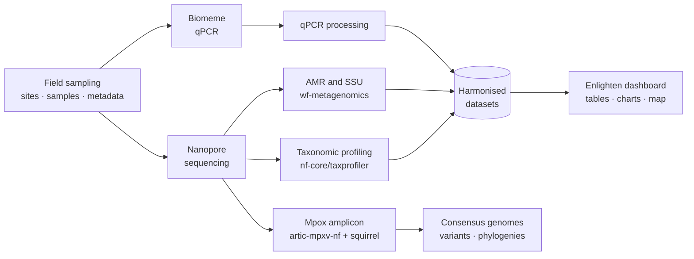

# ODIN

**Open-source tooling for wastewater and environmental pathogen surveillance.**

ODIN builds field-deployable tools for detecting and tracking infectious disease from
environmental samples, and for turning the results into something public health teams can act
on. The software here covers the full path from a sequencing run or a qPCR plate through to an
interactive dashboard — running on a single workstation, with no cloud account and no
continuous internet connection.

The tools were developed for surveillance deployments in sub-Saharan Africa, where analysis
often has to happen close to the sampling point, in a mobile laboratory, on unreliable
connectivity.

| Project | Focus | Grant |
| --- | --- | --- |
| **ODIN** | Environmental genomic surveillance of waterborne infectious disease | 101103253 (Horizon Europe / EDCTP3) |
| **ODIN-MPOX** | Wastewater and environmental surveillance for Mpox | 101195186 (HORIZON-JU-GH-EDCTP3-2024-Mpox) |

---

## Start here

| If you want to… | Go to |
| --- | --- |
| See the whole system running, with example data | [odin-pipeline-starter-kit](https://github.com/ODIN-consortium/odin-pipeline-starter-kit) |
| Run surveillance analyses through a browser | [odin-pipeline-web-application](https://github.com/ODIN-consortium/odin-pipeline-web-application) |
| Drive the same pipelines from the command line | [odin-pipeline-scripts](https://github.com/ODIN-consortium/odin-pipeline-scripts) |
| Look at the sequence analysis workflows themselves | [odin-sequence-analysis-pipeline](https://github.com/ODIN-consortium/odin-sequence-analysis-pipeline) |

If you are evaluating ODIN for the first time, start with the **starter-kit** — it ships with
pre-populated metagenomics and Mpox amplicon runs, so you can see the complete workflow without
needing data of your own.

---

## Repositories

### [odin-pipeline-web-application](https://github.com/ODIN-consortium/odin-pipeline-web-application)

The main application. A browser-based interface that registers sites, samples and sequencing
runs in a managed database, discovers MinKNOW and Biomeme data on disk, launches the analysis
pipelines with live log streaming, and post-processes results into visualisation-ready datasets.

Because the metadata each pipeline needs is captured before a run can start, the application
catches the omissions that are easy to make under field conditions — an unlinked barcode, a
sample with no site, a site with no coordinates — rather than letting them surface later as gaps
in the results.

*FastAPI · Angular · SQLite · Nextflow · Docker Compose · AGPL-3.0*

### [odin-pipeline-scripts](https://github.com/ODIN-consortium/odin-pipeline-scripts)

The command-line layer, and the more scriptable route to the same analyses. Shell and Python
tooling that runs the taxonomic, AMR, SSU, Mpox and qPCR workflows, validates the metadata
workbook against what is actually on disk, and builds the datasets the dashboard reads.

*Python · Bash · Nextflow · AGPL-3.0*

### [odin-pipeline-starter-kit](https://github.com/ODIN-consortium/odin-pipeline-starter-kit)

A self-contained demonstration deployment, packaged with example sequencing runs so the full
system can be evaluated end to end without access to project data. The starter kit can be adapted
to your own application.

*Docker Compose · Git LFS · AGPL-3.0*

### [odin-sequence-analysis-pipeline](https://github.com/ODIN-consortium/odin-sequence-analysis-pipeline)

Sequence analysis workflows configured for ODIN data, one per branch: `longread_analysis`
(long-read metagenomic profiling, based on [nf-core/taxprofiler](https://nf-co.re/taxprofiler))
and `wgs_analysis` (bacterial whole-genome analysis, based on
[Bactopia](https://bactopia.github.io/)). See the individual branches — the `main` branch is an
index only.

*Nextflow · upstream licences apply*

---

## How the pieces fit

Metadata is the spine of the whole thing. Every sequencing barcode and every qPCR measurement
resolves back to a sampling site with coordinates and a collection date, which is what makes the
results comparable across runs, sites and countries.

---

## What the pipelines do

- **Taxonomic profiling** — Kraken2 classification and Krona visualisation via nf-core/taxprofiler,
  annotated against a project pathogen watch list.
- **Antimicrobial resistance** — resistance gene detection against the CARD database.
- **Small-subunit rRNA** — 16S/18S profiling against SILVA.
- **Mpox** — amplicon read mapping, variant calling and consensus generation with
  [artic-mpxv-nf](https://github.com/artic-network/artic-mpxv-nf), followed by
  [squirrel](https://github.com/aineniamh/squirrel) for APOBEC3-aware alignment and
  maximum-likelihood phylogenetics.
- **qPCR** — Cq extraction, abundance calculation, replicate-aware quality flagging and
  presence calls for the Biomeme assay panel.

---

## Licence

The pipeline scripts, the web application and its starter kit deployment are released under the
**GNU Affero General Public License v3.0**. Third-party workflows invoked by the pipelines keep
their own upstream licences, which are documented in the respective repositories.

AGPL-3.0 was chosen deliberately: these are public health tools, intended to be adopted and
adapted by national institutions, and the licence keeps downstream improvements available to the
wider surveillance community.

---

## Funding and acknowledgement

ODIN and ODIN-MPOX are funded by the European Union through the Global Health EDCTP3 Joint
Undertaking. Views and opinions expressed are those of the authors only and do not necessarily
reflect those of the European Union or the Global Health EDCTP3 Joint Undertaking; neither can be
held responsible for them.

The software is provided as-is, without warranty or guaranteed support. Please review the
security notes in each repository before deploying on a shared or untrusted network.
